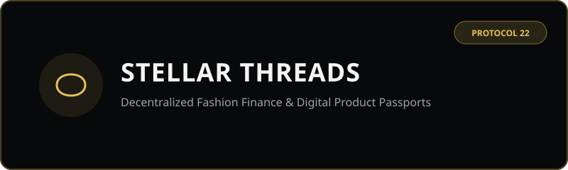
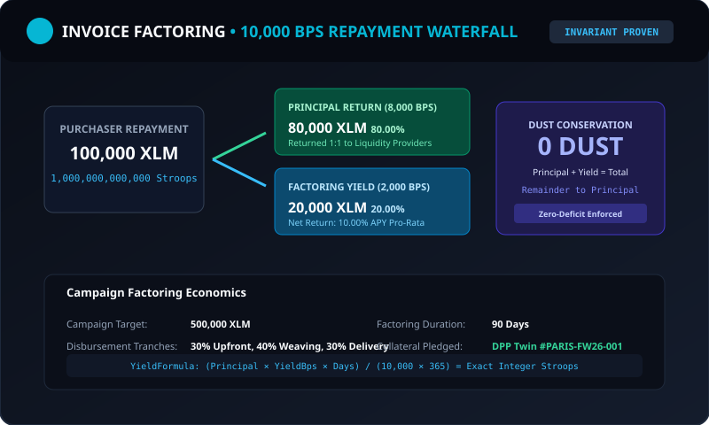

# 🧵 Stellar Threads — Frontend dApp Portal

<div align="center">
  
</div>

<div align="center">

[](https://stellar.org)
[](https://nextjs.org)
[](https://tailwindcss.com)
[](src/__tests__/)
[](https://stellar-threads.netlify.app)
[](LICENSE)

</div>

> **Decentralized Luxury Fashion Finance (FashionFi) & Digital Product Passport Portal powered by Stellar Soroban.**

---

## 🎨 Overview

The **Stellar Threads Frontend Portal** is a production-grade, editorial luxury web application built with **Next.js**, **React 19**, and **Tailwind CSS**. It connects directly to Stellar Testnet smart contracts through **Freighter**, **Lobstr**, and **xBull** via the **Stellar Wallets Kit**.

Live Production URL: **[https://stellar-threads.netlify.app](https://stellar-threads.netlify.app)**

---

## 📸 dApp Portal Screenshots

### 1. Main Dashboard & Milestone Escrow Stepper
<div align="center">
  
</div>

### 2. EU Digital Product Passport & Physical Twin Verification
<div align="center">
  
</div>

### 3. Invoice Factoring Waterfall & Yield Engine
<div align="center">
  
</div>

---

## 💻 Key Features

1. **Multi-Wallet Support**: One-click connection with Freighter, Lobstr, and xBull using the Stellar Wallets Kit.
2. **Instant Friendbot Faucet**: Top up testnet accounts with 10,000 XLM directly from the UI via one click.
3. **4-Stage Milestone Escrow Tracker**: Visual progression for Deposit, Production, Inspection, and Settlement with dust-free 10,000 BPS payment splits.
4. **Interactive Factoring Calculator**: Real-time Stroop return and APY slider calculations for invoice liquidity.
5. **NFC / QR Garment Verification**: Pure vector SVG QR code generation and SHA-256 physical twin verification.
6. **Proof-of-Reserve Solvency Auditor**: Live on-chain reserve ratio monitor confirming 100% solvency backing.
7. **Dispute Resolution & Partial Settlement**: Interactive slider allowing buyer and atelier to negotiate custom refund ratios on-chain.
8. **Crash Resilience**: React Error Boundary with diagnostic error codes and one-click recovery.

---

## 🚀 Development Setup & Testing

```bash
# 1. Install dependencies
npm install

# 2. Run TypeScript typecheck (0 errors)
npm run typecheck

# 3. Run ESLint code inspection (0 warnings)
npm run lint

# 4. Run all 16 Vitest component test suites (47 tests passing)
npm test

# 5. Build optimized static production bundle for Netlify
npm run build

# 6. Start local development server
npm run dev
```

---

## 🌐 Production Deployment (Netlify)

The application is configured for continuous deployment on Netlify using static export:
- **Build Command**: `npm run build`
- **Publish Directory**: `out`
- **Security Headers**: Strict CSP, HSTS (`max-age=31536000`), X-Frame-Options (`DENY`), and X-Content-Type-Options (`nosniff`) defined in `netlify.toml`.
- **SPA Routing**: Automatic catch-all redirects via `public/_redirects`.

---

## 📄 License

Licensed under the Apache License, Version 2.0. See [LICENSE](LICENSE) for details.
